# Database and Storage

<cite>
**Referenced Files in This Document**
- [local-persistence.json](file://local-persistence/local-persistence.json)
- [sqlite.indexes.json](file://local-persistence/sqlite.indexes.json)
- [sqlite.rules](file://local-persistence/sqlite.rules)
- [storage.rules](file://local-persistence/storage.rules)
- [local-persistence.ts](file://src/config/local-persistence.ts)
- [sqliteService.ts](file://src/services/local-persistence/sqliteService.ts)
- [sqliteAdminService.ts](file://src/services/local-persistence/sqliteAdminService.ts)
- [local-persistenceStorageService.ts](file://src/services/local-persistence/local-persistenceStorageService.ts)
- [local-persistenceStorageSimplified.ts](file://src/services/local-persistence/local-persistenceStorageSimplified.ts)
- [streamingLocal persistenceUpload.ts](file://src/services/local-persistence/streamingLocal persistenceUpload.ts)
- [smartLocal persistenceCache.ts](file://src/services/cache/smartLocal persistenceCache.ts)
- [segmentationJobService.ts](file://src/services/local-persistence/segmentationJobService.ts)
- [sheetSage.ts](file://src/types/sheetSage.ts)
- [extensions.py](file://python_backend/extensions.py)
</cite>

## Table of Contents
1. [Introduction](#introduction)
2. [Project Structure](#project-structure)
3. [Core Components](#core-components)
4. [Architecture Overview](#architecture-overview)
5. [Detailed Component Analysis](#detailed-component-analysis)
6. [Dependency Analysis](#dependency-analysis)
7. [Performance Considerations](#performance-considerations)
8. [Troubleshooting Guide](#troubleshooting-guide)
9. [Conclusion](#conclusion)
10. [Appendices](#appendices)

## Introduction
This document explains the database and storage systems powering ChordMiniApp’s audio analysis pipeline. It covers Local persistence integration (SQLite and Cloud Storage), security rules, indexing, caching, and operational workflows for transcriptions, translations, lyrics, key detections, segmentation jobs, and melody caches. It also documents storage architecture, upload/download processes, cleanup mechanisms, and performance strategies, including offline resilience, real-time updates, and backup considerations.

## Project Structure
The database and storage layer spans three main areas:
- Local persistence configuration and rules: SQLite and Cloud Storage rules and indexes
- Client-side Local persistence SDK integration: initialization, auth, and IP rate limiting
- Services for SQLite and Storage: CRUD, caching, and streaming uploads

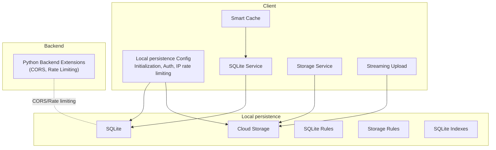

**Diagram sources**
- [local-persistence.json:1-10](file://local-persistence/local-persistence.json#L1-L10)
- [sqlite.rules:1-289](file://local-persistence/sqlite.rules#L1-L289)
- [storage.rules:1-92](file://local-persistence/storage.rules#L1-L92)
- [local-persistence.ts:1-537](file://src/config/local-persistence.ts#L1-L537)
- [sqliteService.ts:1-1173](file://src/services/local-persistence/sqliteService.ts#L1-L1173)
- [local-persistenceStorageService.ts:1-414](file://src/services/local-persistence/local-persistenceStorageService.ts#L1-L414)
- [streamingLocal persistenceUpload.ts:1-563](file://src/services/local-persistence/streamingLocal persistenceUpload.ts#L1-L563)
- [smartLocal persistenceCache.ts:1-343](file://src/services/cache/smartLocal persistenceCache.ts#L1-L343)
- [extensions.py:1-93](file://python_backend/extensions.py#L1-L93)

**Section sources**
- [local-persistence.json:1-10](file://local-persistence/local-persistence.json#L1-L10)
- [local-persistence.ts:1-537](file://src/config/local-persistence.ts#L1-L537)

## Core Components
- Local persistence configuration and rules define the schema, access control, and performance indexes for SQLite and Cloud Storage.
- SQLite service encapsulates typed CRUD operations for transcriptions, melody results, and enrichment updates.
- Storage services manage audio file uploads, metadata caching, and streaming uploads without local disk storage.
- Smart cache reduces repeated reads and mitigates incomplete records.
- Segmentation job service manages asynchronous SongFormer jobs with TTL and cleanup.
- Python backend extensions provide CORS and rate limiting for server-side integrations.

**Section sources**
- [sqliteService.ts:63-102](file://src/services/local-persistence/sqliteService.ts#L63-L102)
- [local-persistenceStorageService.ts:1-414](file://src/services/local-persistence/local-persistenceStorageService.ts#L1-L414)
- [smartLocal persistenceCache.ts:25-343](file://src/services/cache/smartLocal persistenceCache.ts#L25-L343)
- [segmentationJobService.ts:29-48](file://src/services/local-persistence/segmentationJobService.ts#L29-L48)
- [extensions.py:1-93](file://python_backend/extensions.py#L1-L93)

## Architecture Overview
The system integrates client-side Local persistence SDK with SQLite and Cloud Storage. Authentication is handled via anonymous sign-in with persistence and IP rate limiting. Data flows include:
- Transcription and melody results stored in SQLite with normalized schemas
- Audio files stored in Cloud Storage with strict naming and size constraints
- Streaming uploads for large files bypassing local disk
- Caching for improved latency and resilience

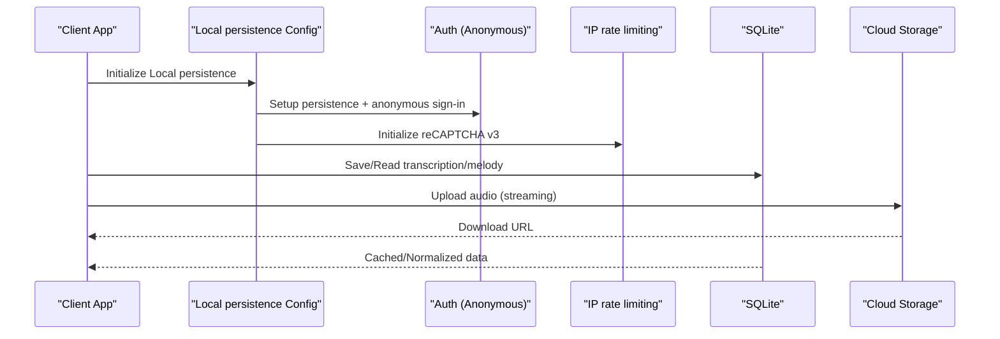

**Diagram sources**
- [local-persistence.ts:43-125](file://src/config/local-persistence.ts#L43-L125)
- [local-persistence.ts:147-252](file://src/config/local-persistence.ts#L147-L252)
- [local-persistence.ts:475-514](file://src/config/local-persistence.ts#L475-L514)
- [sqliteService.ts:584-609](file://src/services/local-persistence/sqliteService.ts#L584-L609)
- [streamingLocal persistenceUpload.ts:34-128](file://src/services/local-persistence/streamingLocal persistenceUpload.ts#L34-L128)

## Detailed Component Analysis

### SQLite Collections and Data Models
- Transcriptions: Stores beat/chord analysis with optional synchronized chords, key signature, BPM, time signature, and enrichment fields. Includes homepage variant scoring and search keys.
- Melody: Stores Sheet Sage melody transcription results with note events, beats, tempo, and counts.
- Translations and Lyrics: Store translated lyrics and raw transcriptions respectively.
- Key detections: Stores cached key analysis results.
- Segmentations: Asynchronous job state for SongFormer with TTL and cleanup.
- Admin and Metrics: Restricted collections for maintenance and monitoring.

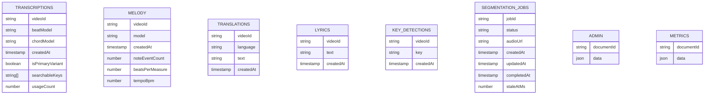

**Diagram sources**
- [sqliteService.ts:63-102](file://src/services/local-persistence/sqliteService.ts#L63-L102)
- [sqliteService.ts:104-108](file://src/services/local-persistence/sqliteService.ts#L104-L108)
- [segmentationJobService.ts:29-48](file://src/services/local-persistence/segmentationJobService.ts#L29-L48)
- [sqlite.rules:123-140](file://local-persistence/sqlite.rules#L123-L140)
- [sqlite.rules:196-206](file://local-persistence/sqlite.rules#L196-L206)
- [sqlite.rules:208-218](file://local-persistence/sqlite.rules#L208-L218)
- [sqlite.rules:266-281](file://local-persistence/sqlite.rules#L266-L281)

**Section sources**
- [sqliteService.ts:63-102](file://src/services/local-persistence/sqliteService.ts#L63-L102)
- [sqliteService.ts:104-108](file://src/services/local-persistence/sqliteService.ts#L104-L108)
- [segmentationJobService.ts:29-48](file://src/services/local-persistence/segmentationJobService.ts#L29-L48)
- [sqlite.rules:123-140](file://local-persistence/sqlite.rules#L123-L140)
- [sqlite.rules:196-206](file://local-persistence/sqlite.rules#L196-L206)
- [sqlite.rules:208-218](file://local-persistence/sqlite.rules#L208-L218)
- [sqlite.rules:266-281](file://local-persistence/sqlite.rules#L266-L281)

### SQLite Indexes and Queries
- Composite indexes support primary variant selection and search filtering on transcriptions.
- Query patterns include equality filters on videoId and ordering by createdAt for pagination and ranking.

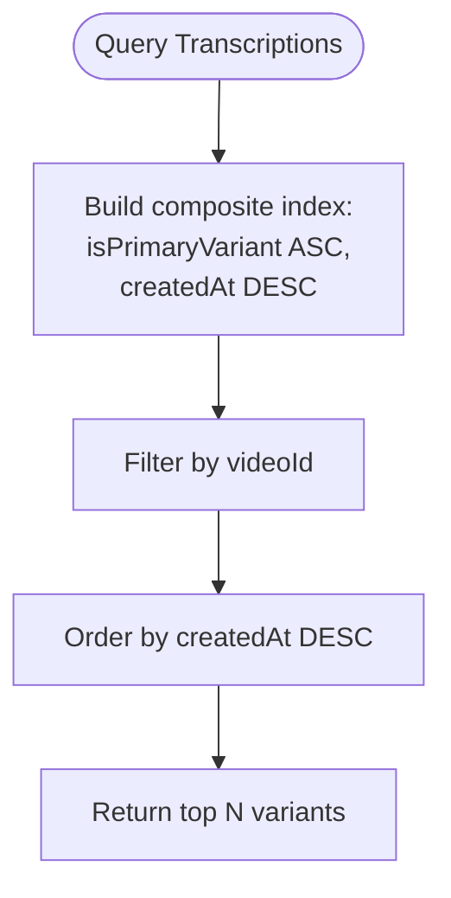

**Diagram sources**
- [sqlite.indexes.json:1-38](file://local-persistence/sqlite.indexes.json#L1-L38)
- [sqliteService.ts:752-756](file://src/services/local-persistence/sqliteService.ts#L752-L756)

**Section sources**
- [sqlite.indexes.json:1-38](file://local-persistence/sqlite.indexes.json#L1-L38)
- [sqliteService.ts:752-756](file://src/services/local-persistence/sqliteService.ts#L752-L756)

### Security Rules and Access Control
- SQLite rules:
  - Validation helpers enforce field constraints and sizes.
  - Public caches (audioCache, transcriptionCache, translationCache) allow read/write with relaxed validation.
  - Transcriptions, translations, lyrics, key detections: permissive create/update for development; deletions restricted to admins.
  - Admin and metrics collections restricted to trusted emails.
  - Feedback and error logs accept limited submissions.
- Cloud Storage rules:
  - Audio/video files under strict naming and size constraints.
  - Temporary offload path allows larger files with timestamped filenames.
  - Read access is public for caching; write requires validation.

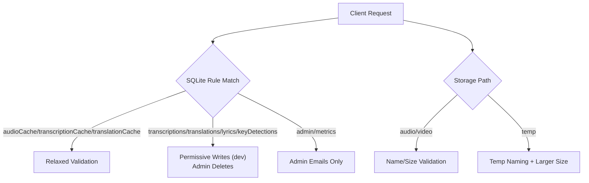

**Diagram sources**
- [sqlite.rules:64-104](file://local-persistence/sqlite.rules#L64-L104)
- [sqlite.rules:106-141](file://local-persistence/sqlite.rules#L106-L141)
- [sqlite.rules:159-194](file://local-persistence/sqlite.rules#L159-L194)
- [sqlite.rules:196-218](file://local-persistence/sqlite.rules#L196-L218)
- [sqlite.rules:266-281](file://local-persistence/sqlite.rules#L266-L281)
- [storage.rules:43-55](file://local-persistence/storage.rules#L43-L55)
- [storage.rules:71-84](file://local-persistence/storage.rules#L71-L84)

**Section sources**
- [sqlite.rules:6-55](file://local-persistence/sqlite.rules#L6-L55)
- [sqlite.rules:64-104](file://local-persistence/sqlite.rules#L64-L104)
- [sqlite.rules:106-141](file://local-persistence/sqlite.rules#L106-L141)
- [sqlite.rules:159-194](file://local-persistence/sqlite.rules#L159-L194)
- [sqlite.rules:196-218](file://local-persistence/sqlite.rules#L196-L218)
- [sqlite.rules:266-281](file://local-persistence/sqlite.rules#L266-L281)
- [storage.rules:10-29](file://local-persistence/storage.rules#L10-L29)
- [storage.rules:43-55](file://local-persistence/storage.rules#L43-L55)
- [storage.rules:71-84](file://local-persistence/storage.rules#L71-L84)

### Client-Side Local persistence Integration
- Runtime configuration loading from a server endpoint for Docker compatibility.
- Anonymous authentication with persistence and retry logic.
- IP rate limiting initialization with reCAPTCHA v3 and debug token support.
- Utility functions to ensure initialization and obtain instances.

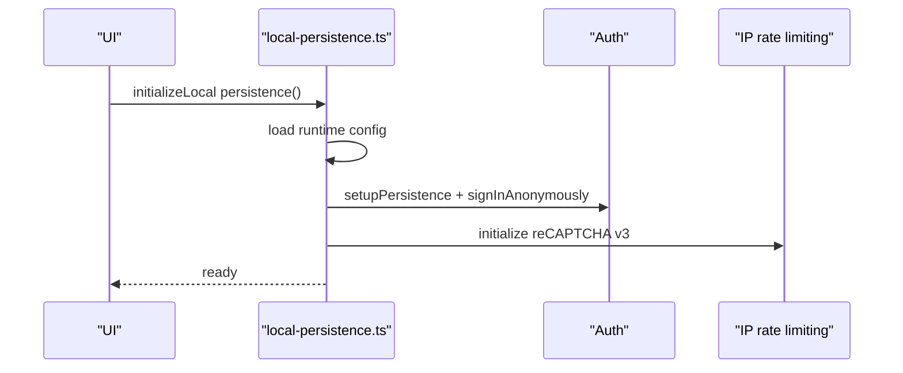

**Diagram sources**
- [local-persistence.ts:43-125](file://src/config/local-persistence.ts#L43-L125)
- [local-persistence.ts:147-252](file://src/config/local-persistence.ts#L147-L252)
- [local-persistence.ts:475-514](file://src/config/local-persistence.ts#L475-L514)

**Section sources**
- [local-persistence.ts:43-125](file://src/config/local-persistence.ts#L43-L125)
- [local-persistence.ts:147-252](file://src/config/local-persistence.ts#L147-L252)
- [local-persistence.ts:475-514](file://src/config/local-persistence.ts#L475-L514)

### SQLite Operations and Caching
- Transcription retrieval and normalization, with caching and usage increment.
- Melody transcription retrieval and persistence.
- Enrichment updates with merging and cache invalidation.
- Homepage variant metadata synchronization across variants.

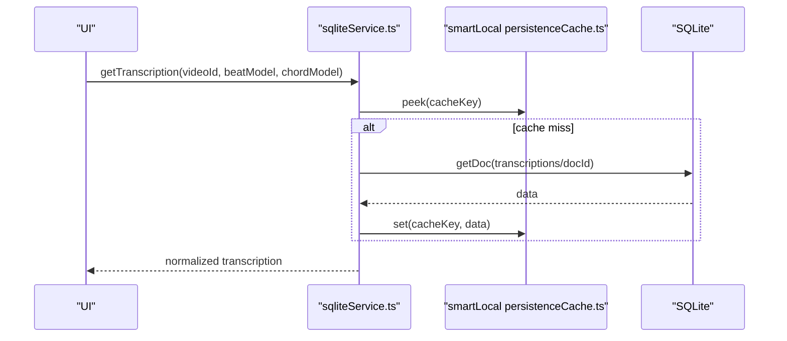

**Diagram sources**
- [sqliteService.ts:405-469](file://src/services/local-persistence/sqliteService.ts#L405-L469)
- [smartLocal persistenceCache.ts:73-146](file://src/services/cache/smartLocal persistenceCache.ts#L73-L146)

**Section sources**
- [sqliteService.ts:405-469](file://src/services/local-persistence/sqliteService.ts#L405-L469)
- [sqliteService.ts:524-577](file://src/services/local-persistence/sqliteService.ts#L524-L577)
- [sqliteService.ts:611-686](file://src/services/local-persistence/sqliteService.ts#L611-L686)
- [smartLocal persistenceCache.ts:25-343](file://src/services/cache/smartLocal persistenceCache.ts#L25-L343)

### Cloud Storage Management
- Audio file upload with unique naming and metadata extraction.
- Batch lookup of existing audio files by video ID.
- Streaming upload from external URLs with retry and budget-aware timeouts.
- Simplified storage service that prioritizes Cloud Storage as source of truth and maintains short-lived in-memory metadata.

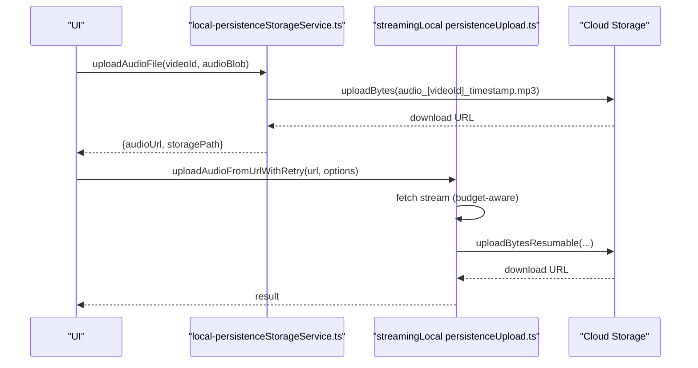

**Diagram sources**
- [local-persistenceStorageService.ts:196-301](file://src/services/local-persistence/local-persistenceStorageService.ts#L196-L301)
- [streamingLocal persistenceUpload.ts:273-431](file://src/services/local-persistence/streamingLocal persistenceUpload.ts#L273-L431)

**Section sources**
- [local-persistenceStorageService.ts:196-301](file://src/services/local-persistence/local-persistenceStorageService.ts#L196-L301)
- [local-persistenceStorageService.ts:308-346](file://src/services/local-persistence/local-persistenceStorageService.ts#L308-L346)
- [streamingLocal persistenceUpload.ts:34-128](file://src/services/local-persistence/streamingLocal persistenceUpload.ts#L34-L128)
- [streamingLocal persistenceUpload.ts:273-431](file://src/services/local-persistence/streamingLocal persistenceUpload.ts#L273-L431)
- [local-persistenceStorageSimplified.ts:119-276](file://src/services/local-persistence/local-persistenceStorageSimplified.ts#L119-L276)

### Segmentation Jobs Lifecycle
- Job creation with request hash deduplication and update token verification.
- Status transitions with TTL-based staleness checks.
- Cleanup of stale jobs and deletion of non-completed jobs by request hash.

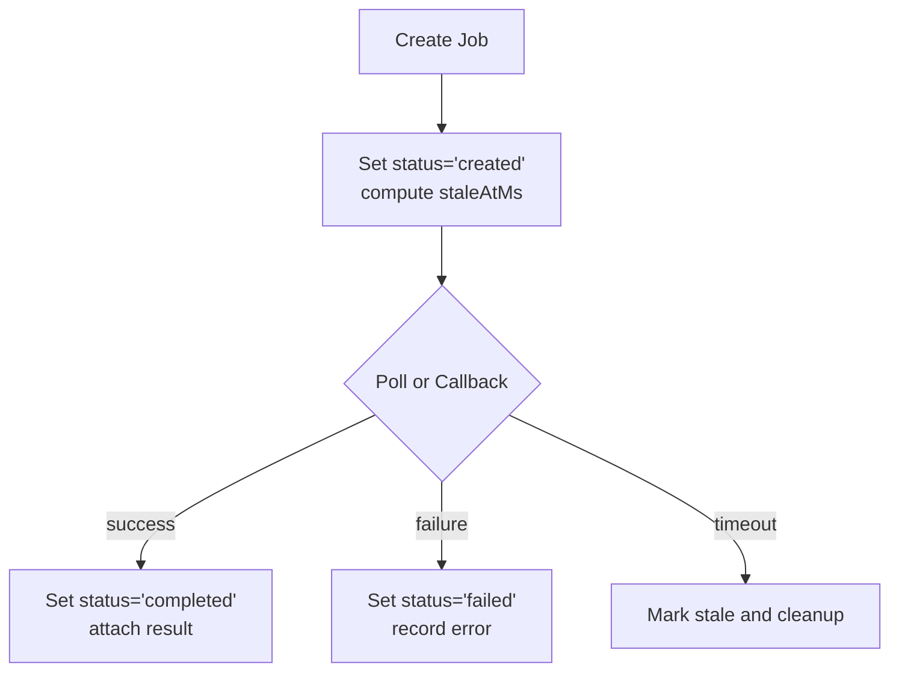

**Diagram sources**
- [segmentationJobService.ts:147-179](file://src/services/local-persistence/segmentationJobService.ts#L147-L179)
- [segmentationJobService.ts:204-226](file://src/services/local-persistence/segmentationJobService.ts#L204-L226)
- [segmentationJobService.ts:276-318](file://src/services/local-persistence/segmentationJobService.ts#L276-L318)

**Section sources**
- [segmentationJobService.ts:147-179](file://src/services/local-persistence/segmentationJobService.ts#L147-L179)
- [segmentationJobService.ts:204-226](file://src/services/local-persistence/segmentationJobService.ts#L204-L226)
- [segmentationJobService.ts:276-318](file://src/services/local-persistence/segmentationJobService.ts#L276-L318)

### Melody Data Model
- Melody transcription results include note events, beat times, tempo, and counts, normalized for consistency.

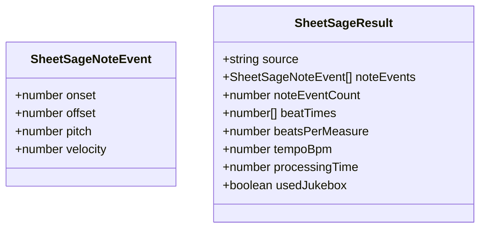

**Diagram sources**
- [sheetSage.ts:1-19](file://src/types/sheetSage.ts#L1-L19)

**Section sources**
- [sheetSage.ts:1-19](file://src/types/sheetSage.ts#L1-L19)

### Backend CORS and Rate Limiting
- Python backend initializes CORS, rate limiting, and logging to complement client-side Local persistence operations.

**Section sources**
- [extensions.py:17-93](file://python_backend/extensions.py#L17-L93)

## Dependency Analysis
- Client-side Local persistence SDK depends on runtime configuration and IP rate limiting.
- SQLite service depends on typed models and cache utilities.
- Storage services depend on local audio storage SDK and streaming utilities.
- Admin operations depend on Google Auth and SQLite REST APIs.

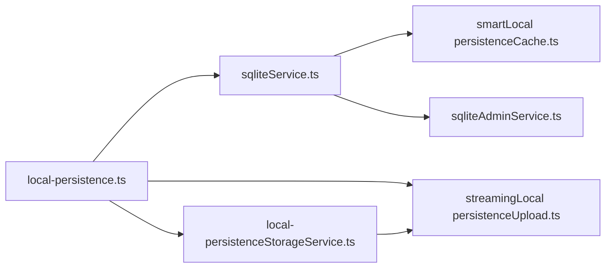

**Diagram sources**
- [local-persistence.ts:1-537](file://src/config/local-persistence.ts#L1-L537)
- [sqliteService.ts:1-1173](file://src/services/local-persistence/sqliteService.ts#L1-L1173)
- [local-persistenceStorageService.ts:1-414](file://src/services/local-persistence/local-persistenceStorageService.ts#L1-L414)
- [streamingLocal persistenceUpload.ts:1-563](file://src/services/local-persistence/streamingLocal persistenceUpload.ts#L1-L563)
- [smartLocal persistenceCache.ts:1-343](file://src/services/cache/smartLocal persistenceCache.ts#L1-L343)
- [sqliteAdminService.ts:1-313](file://src/services/local-persistence/sqliteAdminService.ts#L1-L313)

**Section sources**
- [local-persistence.ts:1-537](file://src/config/local-persistence.ts#L1-L537)
- [sqliteService.ts:1-1173](file://src/services/local-persistence/sqliteService.ts#L1-L1173)
- [local-persistenceStorageService.ts:1-414](file://src/services/local-persistence/local-persistenceStorageService.ts#L1-L414)
- [streamingLocal persistenceUpload.ts:1-563](file://src/services/local-persistence/streamingLocal persistenceUpload.ts#L1-L563)
- [smartLocal persistenceCache.ts:1-343](file://src/services/cache/smartLocal persistenceCache.ts#L1-L343)
- [sqliteAdminService.ts:1-313](file://src/services/local-persistence/sqliteAdminService.ts#L1-L313)

## Performance Considerations
- Caching: Smart cache reduces repeated SQLite queries and suppresses warnings for incomplete records.
- Indexing: Composite indexes optimize primary variant selection and search filtering.
- Streaming uploads: Resumable uploads and budget-aware fetches minimize serverless timeouts.
- Offline resilience: Anonymous auth persistence and IP rate limiting improve reliability.
- Rate limiting: SQLite rules include a basic rate-limit helper; backend extensions provide CORS and rate limiting.

[No sources needed since this section provides general guidance]

## Troubleshooting Guide
- Database connectivity issues:
  - CORS errors disable SQLite for the session; the system logs and disables SQLite to avoid repeated failures.
  - Verify Local persistence initialization and runtime config loading.
- Permission problems:
  - SQLite rules are temporarily permissive for development; ensure admin deletions are performed by authorized users.
  - Storage rules enforce filename patterns and sizes; confirm uploads meet naming and size constraints.
- Performance optimization:
  - Use caching utilities to reduce repeated reads.
  - Leverage composite indexes for frequent queries.
  - Prefer streaming uploads for large files to avoid local disk constraints.
- Real-time updates and offline persistence:
  - Anonymous authentication persistence helps maintain state across reloads.
  - IP rate limiting protects against abuse and improves request reliability.
- Backup strategies:
  - Use SQLite Admin APIs for bulk deletions and administrative tasks.
  - Maintain Cloud Storage as the source of truth for audio files.

**Section sources**
- [sqliteService.ts:456-468](file://src/services/local-persistence/sqliteService.ts#L456-L468)
- [local-persistence.ts:147-252](file://src/config/local-persistence.ts#L147-L252)
- [local-persistence.ts:475-514](file://src/config/local-persistence.ts#L475-L514)
- [sqliteAdminService.ts:243-257](file://src/services/local-persistence/sqliteAdminService.ts#L243-L257)

## Conclusion
ChordMiniApp’s database and storage architecture balances flexibility and performance. SQLite serves structured analysis results with strong caching and indexing, while Cloud Storage hosts audio files with strict naming and streaming capabilities. Security rules provide layered access control, and client-side initialization ensures resilience and protection via IP rate limiting and anonymous auth. Operational services manage asynchronous jobs and cleanup, enabling scalable and maintainable audio analysis workflows.

[No sources needed since this section summarizes without analyzing specific files]

## Appendices

### Collection Organization Summary
- transcriptions: Beat/chord analysis with enrichment and homepage variant metadata
- melody: Sheet Sage melody transcription results
- translations and lyrics: Translated and raw lyrics
- keyDetections: Musical key analysis cache
- segmentationJobs: Async SongFormer job state with TTL and cleanup
- admin and metrics: Restricted maintenance and monitoring data

**Section sources**
- [sqliteService.ts:250-254](file://src/services/local-persistence/sqliteService.ts#L250-L254)
- [segmentationJobService.ts:18-27](file://src/services/local-persistence/segmentationJobService.ts#L18-L27)
- [sqlite.rules:123-141](file://local-persistence/sqlite.rules#L123-L141)
- [sqlite.rules:196-218](file://local-persistence/sqlite.rules#L196-L218)
- [sqlite.rules:266-281](file://local-persistence/sqlite.rules#L266-L281)
