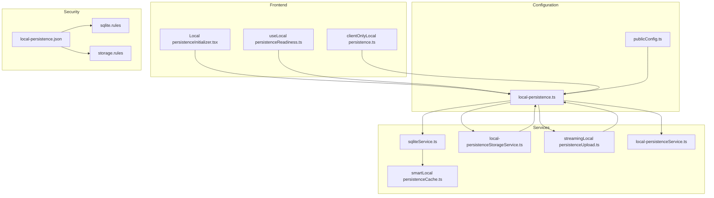
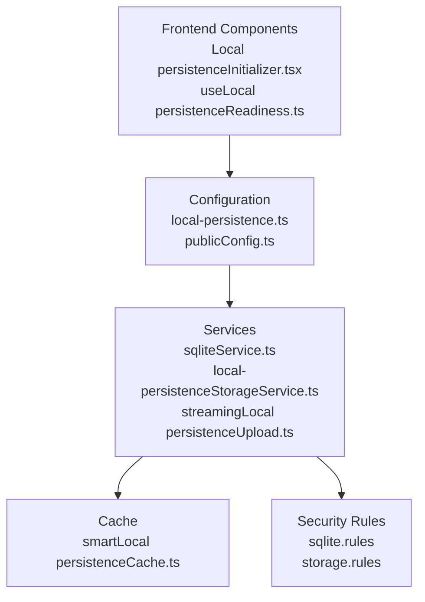
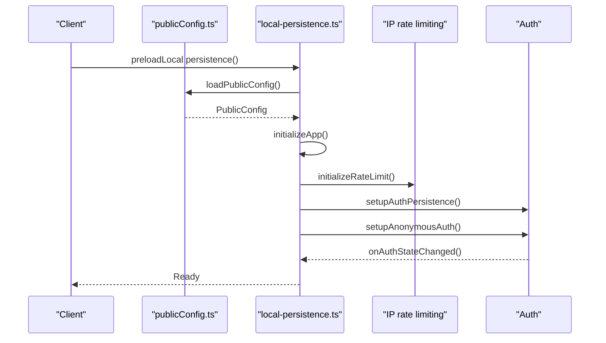
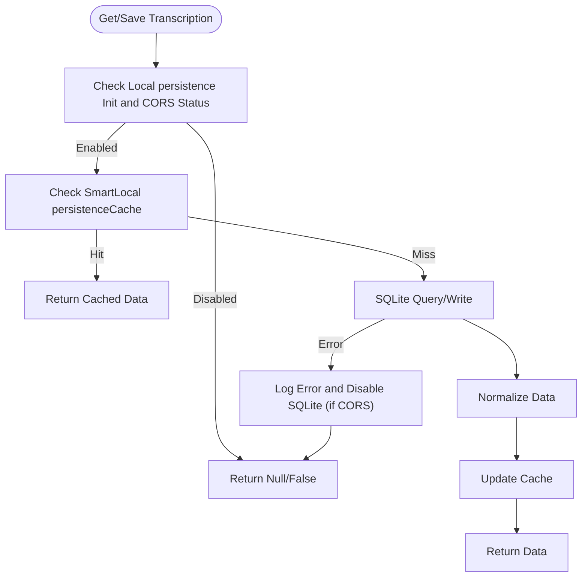
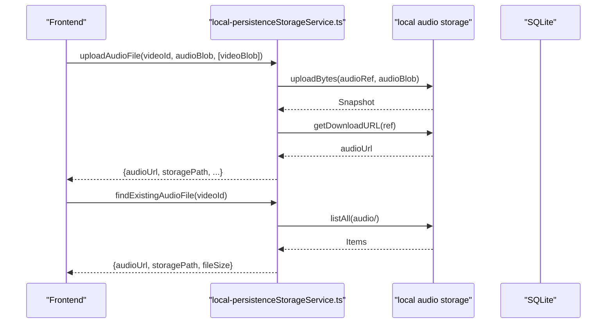
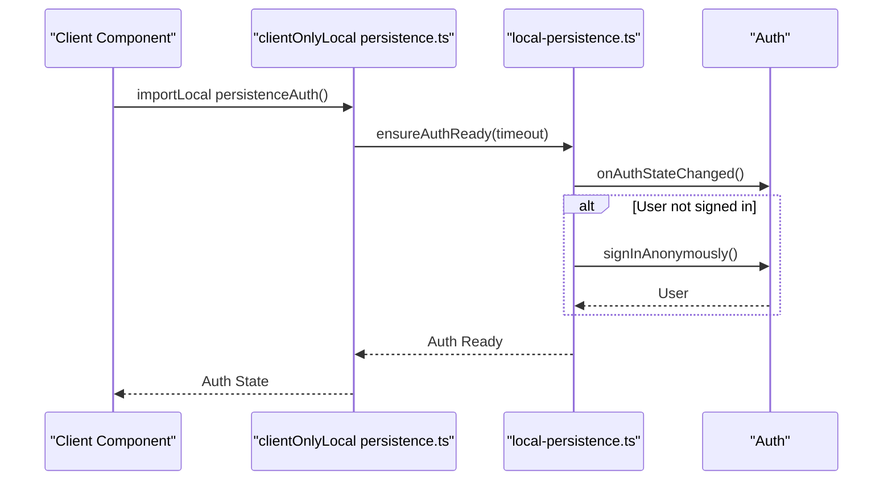
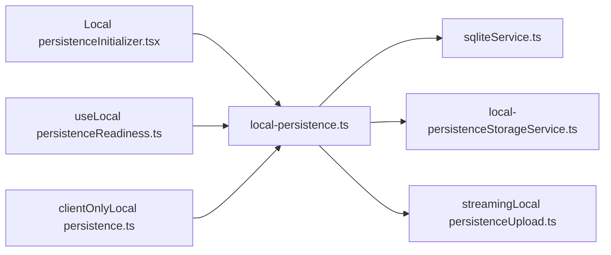
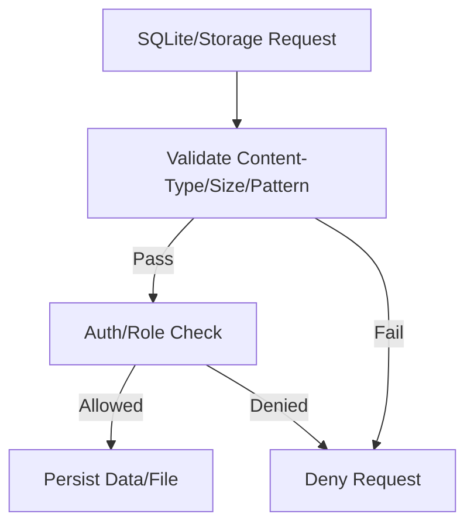
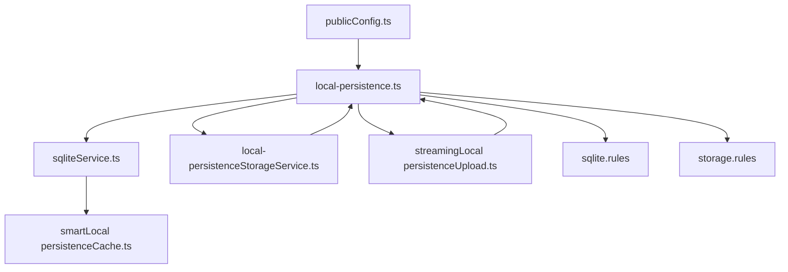

# Local persistence Service

<cite>
**Referenced Files in This Document**
- [local-persistence.ts](file://src/config/local-persistence.ts)
- [local-persistenceService.ts](file://src/services/local-persistence/local-persistenceService.ts)
- [sqliteService.ts](file://src/services/local-persistence/sqliteService.ts)
- [local-persistenceStorageService.ts](file://src/services/local-persistence/local-persistenceStorageService.ts)
- [streamingLocal persistenceUpload.ts](file://src/services/local-persistence/streamingLocal persistenceUpload.ts)
- [Local persistenceInitializer.tsx](file://src/components/layout/Local persistenceInitializer.tsx)
- [useLocal persistenceReadiness.ts](file://src/hooks/local-persistence/useLocal persistenceReadiness.ts)
- [clientOnlyLocal persistence.ts](file://src/utils/clientOnlyLocal persistence.ts)
- [smartLocal persistenceCache.ts](file://src/services/cache/smartLocal persistenceCache.ts)
- [publicConfig.ts](file://src/config/publicConfig.ts)
- [local-persistence.json](file://local-persistence/local-persistence.json)
- [sqlite.rules](file://local-persistence/sqlite.rules)
- [storage.rules](file://local-persistence/storage.rules)
</cite>

## Table of Contents
1. [Introduction](#introduction)
2. [Project Structure](#project-structure)
3. [Core Components](#core-components)
4. [Architecture Overview](#architecture-overview)
5. [Detailed Component Analysis](#detailed-component-analysis)
6. [Dependency Analysis](#dependency-analysis)
7. [Performance Considerations](#performance-considerations)
8. [Troubleshooting Guide](#troubleshooting-guide)
9. [Conclusion](#conclusion)

## Introduction
This document describes the Local persistence service integration powering authentication, real-time database access, and storage management in the ChordMiniApp. It covers SQLite for document-based data storage, local audio storage for audio file management, authentication workflows, frontend integration patterns, security rules enforcement, and offline data synchronization strategies. It also includes practical examples for data persistence, file upload/download operations, and real-time updates for collaborative features.

## Project Structure
The Local persistence integration spans configuration, services, frontend initialization, and security rules:

- Configuration and initialization: centralized in a single module that supports runtime configuration loading for Docker deployments.
- Services: dedicated modules for SQLite operations, Storage operations, and streaming uploads.
- Frontend integration: client components and hooks to preload and monitor Local persistence readiness.
- Security: SQLite and Storage rules enforcing validation, rate limits, and access controls.

**Diagram sources**
- [local-persistence.ts:1-537](file://src/config/local-persistence.ts#L1-L537)
- [local-persistenceService.ts:1-156](file://src/services/local-persistence/local-persistenceService.ts#L1-L156)
- [sqliteService.ts:1-800](file://src/services/local-persistence/sqliteService.ts#L1-L800)
- [local-persistenceStorageService.ts:1-414](file://src/services/local-persistence/local-persistenceStorageService.ts#L1-L414)
- [streamingLocal persistenceUpload.ts:1-563](file://src/services/local-persistence/streamingLocal persistenceUpload.ts#L1-L563)
- [Local persistenceInitializer.tsx:1-62](file://src/components/layout/Local persistenceInitializer.tsx#L1-L62)
- [useLocal persistenceReadiness.ts:1-61](file://src/hooks/local-persistence/useLocal persistenceReadiness.ts#L1-L61)
- [clientOnlyLocal persistence.ts:1-146](file://src/utils/clientOnlyLocal persistence.ts#L1-L146)
- [smartLocal persistenceCache.ts:1-343](file://src/services/cache/smartLocal persistenceCache.ts#L1-L343)
- [publicConfig.ts:1-218](file://src/config/publicConfig.ts#L1-L218)
- [local-persistence.json:1-10](file://local-persistence/local-persistence.json#L1-L10)
- [sqlite.rules:1-289](file://local-persistence/sqlite.rules#L1-L289)
- [storage.rules:1-92](file://local-persistence/storage.rules#L1-L92)

**Section sources**
- [local-persistence.ts:1-537](file://src/config/local-persistence.ts#L1-L537)
- [local-persistence.json:1-10](file://local-persistence/local-persistence.json#L1-L10)

## Core Components
- Local persistence configuration and initialization: runtime configuration loading, lazy initialization, IP rate limiting integration, and anonymous authentication with robust retry logic.
- SQLite service: typed transcription and melody data models, normalization utilities, caching, and resilient read/write operations with CORS handling.
- local audio storage service: audio file upload, metadata retrieval, batch search, and streaming upload with retry and timeout strategies.
- Frontend integration: initializer component and readiness hook to ensure Local persistence is ready before performing operations.
- Security rules: SQLite and Storage rules enforcing validation, rate limits, and access control.

**Section sources**
- [local-persistence.ts:1-537](file://src/config/local-persistence.ts#L1-L537)
- [sqliteService.ts:1-800](file://src/services/local-persistence/sqliteService.ts#L1-L800)
- [local-persistenceStorageService.ts:1-414](file://src/services/local-persistence/local-persistenceStorageService.ts#L1-L414)
- [streamingLocal persistenceUpload.ts:1-563](file://src/services/local-persistence/streamingLocal persistenceUpload.ts#L1-L563)
- [Local persistenceInitializer.tsx:1-62](file://src/components/layout/Local persistenceInitializer.tsx#L1-L62)
- [useLocal persistenceReadiness.ts:1-61](file://src/hooks/local-persistence/useLocal persistenceReadiness.ts#L1-L61)
- [sqlite.rules:1-289](file://local-persistence/sqlite.rules#L1-L289)
- [storage.rules:1-92](file://local-persistence/storage.rules#L1-L92)

## Architecture Overview
The Local persistence integration follows a layered architecture:
- Configuration layer: runtime config loading and initialization orchestration.
- Service layer: SQLite and Storage operations with typed models and caching.
- Frontend integration: client-side initialization and readiness monitoring.
- Security layer: SQLite and Storage rules.

**Diagram sources**
- [local-persistence.ts:1-537](file://src/config/local-persistence.ts#L1-L537)
- [sqliteService.ts:1-800](file://src/services/local-persistence/sqliteService.ts#L1-L800)
- [local-persistenceStorageService.ts:1-414](file://src/services/local-persistence/local-persistenceStorageService.ts#L1-L414)
- [streamingLocal persistenceUpload.ts:1-563](file://src/services/local-persistence/streamingLocal persistenceUpload.ts#L1-L563)
- [smartLocal persistenceCache.ts:1-343](file://src/services/cache/smartLocal persistenceCache.ts#L1-L343)
- [sqlite.rules:1-289](file://local-persistence/sqlite.rules#L1-L289)
- [storage.rules:1-92](file://local-persistence/storage.rules#L1-L92)

## Detailed Component Analysis

### Local persistence Configuration and Initialization
- Runtime configuration loading: fetches environment variables from a server endpoint for Docker compatibility.
- Lazy initialization: defers Local persistence initialization until needed, avoiding SSR issues and enabling graceful fallbacks.
- IP rate limiting integration: initializes reCAPTCHA v3 provider for client-side request protection.
- Authentication: sets persistence and anonymous sign-in with exponential backoff retry logic and timeouts.
- Instance exports: provides async getters for SQLite, Storage, and Auth instances.

**Diagram sources**
- [local-persistence.ts:43-125](file://src/config/local-persistence.ts#L43-L125)
- [publicConfig.ts:63-108](file://src/config/publicConfig.ts#L63-L108)

**Section sources**
- [local-persistence.ts:1-537](file://src/config/local-persistence.ts#L1-L537)
- [publicConfig.ts:1-218](file://src/config/publicConfig.ts#L1-L218)

### SQLite Service for Document-Based Data Storage
- Typed models: transcription and melody data interfaces with normalization utilities.
- Caching: SmartLocal persistenceCache reduces repeated queries and handles incomplete records with TTL and error suppression.
- Resilient operations: graceful handling of CORS/network errors with automatic disabling of SQLite for the session.
- Enrichment and usage tracking: update operations with merge semantics and usage counters.

**Diagram sources**
- [sqliteService.ts:405-469](file://src/services/local-persistence/sqliteService.ts#L405-L469)
- [smartLocal persistenceCache.ts:1-343](file://src/services/cache/smartLocal persistenceCache.ts#L1-L343)

**Section sources**
- [sqliteService.ts:1-800](file://src/services/local-persistence/sqliteService.ts#L1-L800)
- [smartLocal persistenceCache.ts:1-343](file://src/services/cache/smartLocal persistenceCache.ts#L1-L343)

### local audio storage Service for Audio File Management
- Upload operations: converts ArrayBuffer/Blob to Blob, uploads to Storage, and returns download URLs.
- Metadata retrieval: retrieves audio metadata from Storage and composes a standardized model.
- Batch search: lists files under audio/ and matches by video ID pattern.
- Streaming upload: converts ReadableStream to Blob, performs resumable upload with progress tracking and retry logic.
- URL-based upload: fetches audio stream directly and uploads to Storage with budget-aware retries.

**Diagram sources**
- [local-persistenceStorageService.ts:196-301](file://src/services/local-persistence/local-persistenceStorageService.ts#L196-L301)
- [local-persistenceStorageService.ts:40-97](file://src/services/local-persistence/local-persistenceStorageService.ts#L40-L97)

**Section sources**
- [local-persistenceStorageService.ts:1-414](file://src/services/local-persistence/local-persistenceStorageService.ts#L1-L414)
- [streamingLocal persistenceUpload.ts:1-563](file://src/services/local-persistence/streamingLocal persistenceUpload.ts#L1-L563)

### Authentication Workflows
- Anonymous authentication: sets persistence, listens for auth state changes, and attempts anonymous sign-in with exponential backoff.
- Readiness utilities: ensureAuthReady waits for authentication with configurable timeouts and returns user state.
- Client-only operations: guards against SSR and provides safe wrappers for auth operations.

**Diagram sources**
- [clientOnlyLocal persistence.ts:76-131](file://src/utils/clientOnlyLocal persistence.ts#L76-L131)
- [local-persistence.ts:148-329](file://src/config/local-persistence.ts#L148-L329)

**Section sources**
- [local-persistence.ts:1-537](file://src/config/local-persistence.ts#L1-L537)
- [clientOnlyLocal persistence.ts:1-146](file://src/utils/clientOnlyLocal persistence.ts#L1-L146)

### Frontend Integration Patterns
- Initialization: Local persistenceInitializer preloads Local persistence and initializes collections early to prevent cache race conditions.
- Readiness: useLocal persistenceReadiness monitors Local persistence availability and retries on failure.
- Client-only utilities: safe wrappers ensure operations run only on the client and provide fallbacks on SSR.

**Diagram sources**
- [Local persistenceInitializer.tsx:1-62](file://src/components/layout/Local persistenceInitializer.tsx#L1-L62)
- [useLocal persistenceReadiness.ts:1-61](file://src/hooks/local-persistence/useLocal persistenceReadiness.ts#L1-L61)
- [clientOnlyLocal persistence.ts:1-146](file://src/utils/clientOnlyLocal persistence.ts#L1-L146)
- [local-persistence.ts:1-537](file://src/config/local-persistence.ts#L1-L537)

**Section sources**
- [Local persistenceInitializer.tsx:1-62](file://src/components/layout/Local persistenceInitializer.tsx#L1-L62)
- [useLocal persistenceReadiness.ts:1-61](file://src/hooks/local-persistence/useLocal persistenceReadiness.ts#L1-L61)
- [clientOnlyLocal persistence.ts:1-146](file://src/utils/clientOnlyLocal persistence.ts#L1-L146)

### Security Rules Enforcement
- SQLite rules: strict validation functions, rate limiting, and per-collection permissions. Public caches allow read access; admin-only deletions; relaxed validation for cold start scenarios.
- Storage rules: content-type and size validation, filename patterns, and per-path access control. Anonymous uploads allowed with validation; temp path supports larger files for processing.

**Diagram sources**
- [sqlite.rules:1-289](file://local-persistence/sqlite.rules#L1-L289)
- [storage.rules:1-92](file://local-persistence/storage.rules#L1-L92)

**Section sources**
- [sqlite.rules:1-289](file://local-persistence/sqlite.rules#L1-L289)
- [storage.rules:1-92](file://local-persistence/storage.rules#L1-L92)

## Dependency Analysis
- Configuration depends on runtime config loader for environment variables.
- Services depend on configuration for SQLite/Storage/Auth instances.
- Frontend components depend on configuration and readiness hooks.
- Security rules govern all service operations.

**Diagram sources**
- [publicConfig.ts:1-218](file://src/config/publicConfig.ts#L1-L218)
- [local-persistence.ts:1-537](file://src/config/local-persistence.ts#L1-L537)
- [sqliteService.ts:1-800](file://src/services/local-persistence/sqliteService.ts#L1-L800)
- [local-persistenceStorageService.ts:1-414](file://src/services/local-persistence/local-persistenceStorageService.ts#L1-L414)
- [streamingLocal persistenceUpload.ts:1-563](file://src/services/local-persistence/streamingLocal persistenceUpload.ts#L1-L563)
- [smartLocal persistenceCache.ts:1-343](file://src/services/cache/smartLocal persistenceCache.ts#L1-L343)
- [sqlite.rules:1-289](file://local-persistence/sqlite.rules#L1-L289)
- [storage.rules:1-92](file://local-persistence/storage.rules#L1-L92)

**Section sources**
- [publicConfig.ts:1-218](file://src/config/publicConfig.ts#L1-L218)
- [local-persistence.ts:1-537](file://src/config/local-persistence.ts#L1-L537)
- [sqliteService.ts:1-800](file://src/services/local-persistence/sqliteService.ts#L1-L800)
- [local-persistenceStorageService.ts:1-414](file://src/services/local-persistence/local-persistenceStorageService.ts#L1-L414)
- [streamingLocal persistenceUpload.ts:1-563](file://src/services/local-persistence/streamingLocal persistenceUpload.ts#L1-L563)
- [smartLocal persistenceCache.ts:1-343](file://src/services/cache/smartLocal persistenceCache.ts#L1-L343)
- [sqlite.rules:1-289](file://local-persistence/sqlite.rules#L1-L289)
- [storage.rules:1-92](file://local-persistence/storage.rules#L1-L92)

## Performance Considerations
- Caching: SmartLocal persistenceCache reduces repeated queries and suppresses warning spam for incomplete records.
- Lazy initialization: defers Local persistence initialization to avoid blocking initial render.
- Streaming uploads: converts streams to blobs efficiently and uses resumable uploads with progress tracking.
- Retry strategies: exponential backoff and budget-aware retries for URL-based uploads.
- CORS resilience: disables SQLite for the session upon CORS/network errors to prevent repeated failures.

[No sources needed since this section provides general guidance]

## Troubleshooting Guide
- Authentication failures: verify anonymous authentication is enabled in Local persistence Console; check error codes and retry with exponential backoff.
- CORS/network errors: SQLite operations automatically disable SQLite for the session; inspect logs for CORS-related messages.
- Storage upload issues: validate content-type and size; ensure filenames match storage rules; use streaming upload for large files.
- Initialization delays: preload Local persistence early via Local persistenceInitializer and use readiness hooks to coordinate operations.

**Section sources**
- [local-persistence.ts:200-252](file://src/config/local-persistence.ts#L200-L252)
- [sqliteService.ts:462-467](file://src/services/local-persistence/sqliteService.ts#L462-L467)
- [local-persistenceStorageService.ts:282-300](file://src/services/local-persistence/local-persistenceStorageService.ts#L282-L300)
- [streamingLocal persistenceUpload.ts:334-431](file://src/services/local-persistence/streamingLocal persistenceUpload.ts#L334-L431)

## Conclusion
The Local persistence integration in ChordMiniApp provides a robust foundation for authentication, document storage, and audio file management. The architecture emphasizes resilience through caching, graceful degradation on network errors, and strong security rules. Frontend integration patterns ensure smooth initialization and readiness monitoring, while streaming and batch operations optimize performance for audio workflows.
