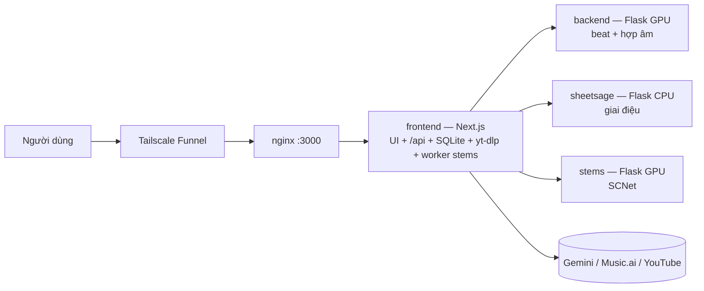

# Tài liệu Chord Mini App

Bộ tài liệu này mô tả hệ thống **đang chạy**. Cập nhật lần cuối: 2026-10-29.

Khi sửa code làm thay đổi kiến trúc, API, schema, biến môi trường hoặc cách deploy, hãy sửa file docs tương ứng trong cùng lần thay đổi.

## Mục lục

| # | File | Nội dung |
|---|---|---|
| 01 | [Tổng quan](01-tong-quan.md) | App làm gì, công nghệ, cấu trúc thư mục |
| 02 | [Kiến trúc](02-kien-truc.md) | Sơ đồ container, phân vai, các luồng xử lý, bảo mật, quyết định thiết kế |
| 03 | [Frontend](03-frontend.md) | Trang, state, services, trang analyze, thuật toán chord grid, quy ước UI |
| 04 | [Backend & ML](04-backend-ml.md) | Flask, model beat/hợp âm, GPU, SheetSage, stems SCNet |
| 05 | [Dữ liệu & lưu trữ](05-du-lieu-luu-tru.md) | SQLite, các bảng, migration, file audio, LRU, backup |
| 06 | [API](06-api.md) | Mọi route `/api/*`, quyền, mã lỗi, API nội bộ |
| 07 | [Đăng nhập & quota](07-xac-thuc-quota.md) | PIN, session, vai trò, quota ẩn danh, tạo tài khoản |
| 08 | [Tải audio YouTube](08-trich-xuat-audio-youtube.md) | Các strategy, yt-dlp, cookie, tải trong trình duyệt |
| 09 | [Deploy](09-deploy-docker-tailscale.md) | Docker Compose, nginx, build lại, Tailscale Funnel, chạy lại sau khi tắt máy |
| 10 | [Chạy local & test](10-chay-local-va-test.md) | Chạy từng service, test, CI |
| 11 | [Biến môi trường](11-bien-moi-truong.md) | Bảng mọi biến, mặc định, build-time hay runtime |
| 12 | [Xử lý sự cố](12-xu-ly-su-co.md) | Triệu chứng → nguyên nhân → cách sửa |
| 13 | [Tồn đọng kỹ thuật](13-ton-dong-ky-thuat.md) | Việc còn dở, code chết, chỗ chưa khớp |

## Đọc gì trước

- **Mới vào dự án:** 01 → 02 → phần mình sắp sửa (03 hoặc 04).
- **Chỉ cần chạy hoặc vận hành:** 09 (deploy) hoặc 10 (local), kèm 12 khi có lỗi.
- **Thêm API hoặc bảng mới:** 06, 05, 07 (quyền).

## Một trang

Ba điều cần nhớ:
1. Mọi lệnh `docker compose` đều phải có `--env-file .env.docker`.
2. Đổi biến `NEXT_PUBLIC_*` thì phải `--build frontend`.
3. Không bao giờ chạy `docker compose down -v`, vì lệnh này xóa hết dữ liệu.
